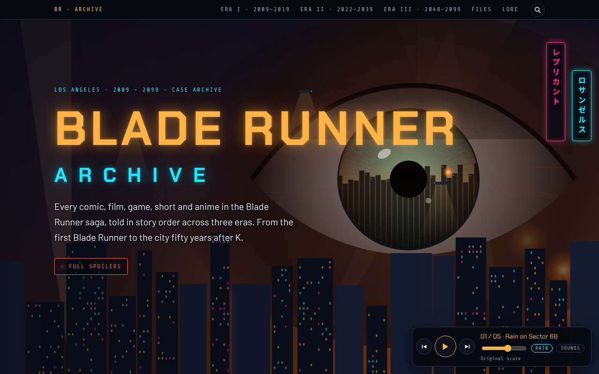
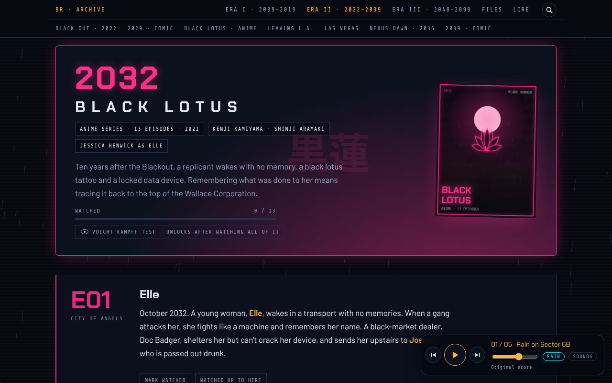
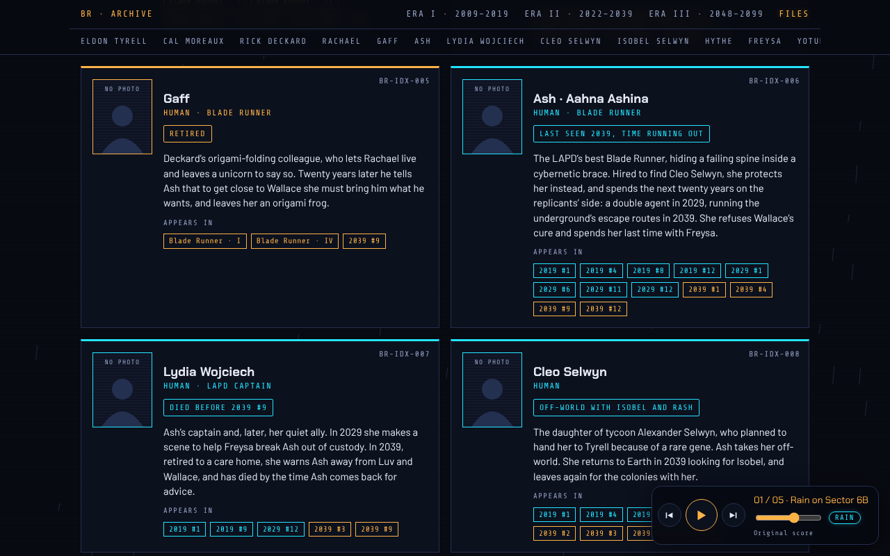
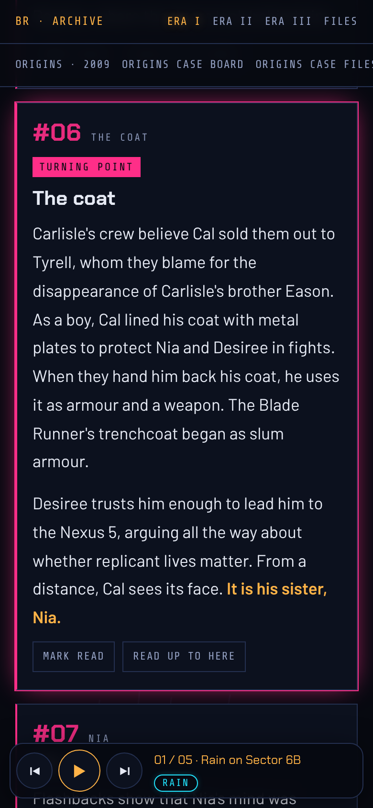
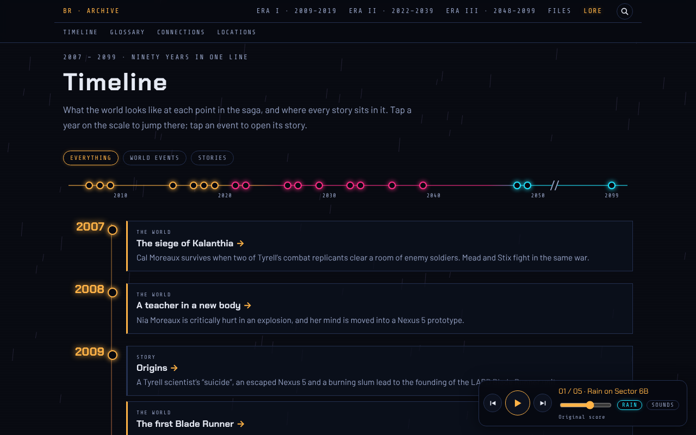

# Blade Runner Archive

An unofficial fan archive of the Blade Runner saga from 2009 to 2099. It covers every comic, film, game, short and anime in story order, with full-spoiler synopses: comics issue by issue, *Black Lotus* episode by episode, and the films and the 1997 game part by part.

**Live site:** https://drugs-bunnny.github.io/Blade-Runner/



## What's in it

- **Three eras**
  - Era I · Before the Blackout, 2009–2019: Origins, Tokyo Nexus, Tokyo Nexus: To Lose Is to Win, Blade Runner (1982), the 1997 game, Blade Runner 2019
  - Era II · After the Blackout, 2022–2039: Black Out 2022, Blade Runner 2029, Black Lotus (anime and both comics), 2036: Nexus Dawn, Blade Runner 2039
  - Era III · The Wallace Age, 2048–2099: 2048: Nowhere to Run, Blade Runner 2049, Blade Runner 2099
- **Character files.** Dossiers for 22 people who appear in more than one story, each linking to every appearance in order.
- **Lore.** A section of its own with four parts:
  - A timeline from 2007 to 2099, with world events and where each story sits.
  - A glossary of terms like the Nexus models, the Blackout and the Voight-Kampff test. Terms in the synopses have a dotted underline; tap one for its definition.
  - A web of connections between the characters. Tap a name to see who they're tied to and how.
  - An original map of California, Nevada and Baja, with Tokyo and the off-world colonies as insets. Tap a place to see the stories set there.
- **Voight-Kampff tests.** Finishing a story unlocks a short quiz on it. Get four in five right to pass as human. Your best score is kept.
- **Reading tracker.** Mark each issue or episode as read, watched or played, see your progress for each story, era and the whole archive, and use Continue to jump to the next unread entry.
- **Search.** Search every synopsis, character file and story intro from the top bar, or press `/` or Ctrl+K. With the spoiler shield on, matches in unread entries are counted but not shown.
- **Share links.** Every story banner and every issue or episode has a *Copy link* button. The link opens the archive at that spot, so you can point a friend at one issue. The buttons are hidden in the Claude copy, which has no address of its own.
- **Spoiler shield.** An optional mode that blurs everything you haven't marked yet. Tap any entry to reveal it.
- **Original art and sound.** A neon poster for every story, five generative ambient tracks, and city-street rain. Everything is drawn and played live in the browser. The music keeps playing as you move around the page, and phones show lock-screen controls.
- **Film touches.**
  - Each era has its own sky: amber smog and flare stacks for Era I, neon rain and billboards for Era II, orange dust for Era III, with searchlights and a patrol spinner over the city.
  - Tap a poster to "enhance" it on an ESPER screen.
  - Finishing a story leaves an origami figure on its banner.
  - A short LAPD terminal start-up plays once per visit, and the neon headings flicker now and then.
  - Optional interface sounds (the Sounds chip in the player, off by default): a Voight-Kampff chirp when you mark an entry and a spinner passing when you change era.
  - Reduced-motion settings turn the animation off.

| Era page | Character files | Phone |
| --- | --- | --- |
|  |  |  |

- **Sync across devices.** Tap *Sync* in the bar at the top of any page to keep reading progress and quiz scores in step on your phone, tablet and computer. Progress is saved to a private gist in your own GitHub account, using a token with only the *gist* permission that you paste in once. A connected device shows a setup code for adding the next one. Each change is timestamped, so devices merge rather than overwrite each other. Sync is in the GitHub Pages copy only.
- **Install it and read offline.** On Android, open the site in Chrome and tap *Install as an app* at the foot of the front page, or choose *Add to Home screen* from the browser menu. It then opens full-screen from its own icon. After one visit, the whole archive works without a connection, music included.



Reading progress, quiz scores and the spoiler setting are saved in the visitor's own browser. Nothing is sent anywhere unless you turn on sync, which talks only to GitHub, using your own token. The fonts come from the site itself, so loading the page makes no requests to other sites.

## Layout

| Path | What it is |
| --- | --- |
| `src/pages/` | The page content: `archive.html` (the hub), `era1.html`–`era3.html` (the synopses and their sources), `people.html` (character files) and `lore.html` (the Lore section's frame) |
| `src/styles/` | `base.css` (palette, type, layout), `site.css` (shared components), `reader.css` (tracker and spoiler shield), `fx.css` (film touches), `lore.css` (Lore and the quizzes), `sync.css` (the sync button and dialog) |
| `src/scripts/` | `city.js` (skyline and rain animation), `score.js` (music and rain sound), `art.js` (posters), `reader.js` (tracker and shield), `share.js` (copy-link buttons), `search.js` (search), `fx.js` (ESPER, origami, start-up screen, neon flicker), `sfx.js` (interface sounds), `lore-data.js` (glossary, timeline, connections, places and quiz questions), `lore.js` (draws the Lore section and the underlined terms), `quiz.js` (Voight-Kampff tests), `sync.js` (GitHub gist sync, Pages copy only), `router.js` (switching views) |
| `src/shell/` | Page furniture: hero text, sub-navigation, the music player, the start-up and ESPER overlays, icon and social tags |
| `src/fonts/` | The three typefaces (Chakra Petch, Barlow, Share Tech Mono) as Latin-subset WOFF2 files, with their licence. The GitHub Pages copy serves them itself; nothing is fetched from Google Fonts |
| `src/pwa/` | The app manifest, the offline service worker and its registration, used by the GitHub Pages copy only |
| `.github/workflows/` | `check.yml`, which runs `tools/check.py` on every push and pull request |
| `build.py` | Assembles everything into one page |
| `docs/` | The built site, served by GitHub Pages, plus its images and fonts |
| `tools/check.py` | The checks that run on every push (see Checking) |
| `tools/test_keyboard.py`, `tools/test_share.py` | The browser tests that run beside them: keyboard use of the pop-ups, and the copy-link buttons |
| `tools/make_files.py` | Regenerates `src/pages/people.html` from the character data |
| `tools/make_images.py` | Renders the link preview card, icons and the screenshots above |

For how to build, publish and add stories, and what's still open, see [MAINTAINING.md](MAINTAINING.md).

## Building

Requires Python 3 and nothing else.

```sh
python3 build.py
```

This writes `docs/index.html`, `docs/manifest.webmanifest`, `docs/sw.js` and `docs/fonts/` for GitHub Pages, and `build/archive.html` for the Claude artifact copy. Commit `docs/` along with your source changes.

Each build is stamped with a build number and date, shown at the foot of every page and on the start-up screen. The number is the commit the build belongs to: the commit count so far, plus one if there are uncommitted source changes. So build and commit together, and the number on the live site matches the commit that published it.

## Checking

```sh
python3 tools/check.py
```

This needs Python 3, Node (to read the Lore data) and a full git clone. It checks that every id is unique and every in-page link, sub-menu entry and poster lands on something real; that the story keys in the tracker, search, glossary, timeline, connections and quizzes all exist, and that the six places that list the stories (tracker, search, Lore, quizzes, origami and character files) agree with each other; that each quiz question has four distinct answers; and that `docs/` matches a fresh build of the sources (build number and date are ignored). GitHub runs the same script on every push and pull request, so a forgotten `python3 build.py` or a mistyped link shows up as a red cross. Add `--no-build` to skip the last check.

```sh
pip install playwright && playwright install chromium
python3 tools/test_keyboard.py
python3 tools/test_share.py
```

The first one drives the built site (`docs/`) with the keyboard alone, in Chromium. The four pop-ups that cover the page (search, sync, the ESPER image and the Voight-Kampff test) must keep Tab inside themselves, close on Escape and hand focus back to the control that opened them, and every control on the Lore and Character files pages must show a visible change when it has focus. It takes about a minute and runs in GitHub as a second job.

To refresh the images, you also need [Playwright for Python](https://playwright.dev/python/) with Chromium:

```sh
python3 tools/make_images.py
```

## Credits

This is an unofficial fan project. Blade Runner is owned by Alcon Entertainment, and the comics are published by Titan Comics. The synopses are original summaries; the sources are listed at the foot of each era. All artwork and music on the site are original and generated in the browser. No official images or audio are used. The typefaces (Chakra Petch, Barlow and Share Tech Mono) are used under the SIL Open Font License; see `src/fonts/LICENSE.txt`.
